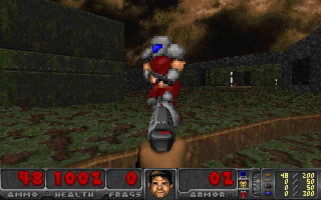

# Doom Room

Real Doom deathmatch inside a Claude artifact. The original engine, compiled to WebAssembly, runs in every player's browser tab, and the players find each other through the artifact's built-in `room` capability. No game server, no WebSocket, no Emscripten.



The red marine above is another browser tab. It is drawn by the real Doom renderer, takes real hitscan damage, and dies with the real death animation, but its position comes over the network 30 times a second.

About 1,200 lines in total, and the Doom engine itself only needed a 15-line patch.

## How it works

```
 tab A                                            tab B
┌──────────────────────────┐                     ┌──────────────────────────┐
│ doom.wasm (single player)│                     │ doom.wasm (single player)│
│   you          ghost of B│                     │   you          ghost of A│
│    │              ▲      │                     │    │              ▲      │
│ net_local()  net_ghost_* │                     │ net_local()  net_ghost_* │
│    ▼              │      │   room presence     │    ▼              │      │
│ net.js ───────────┴──────┼──── pose, shots, ───┼─ net.js ──────────┴──────│
│                          │   hits, kills       │                          │
└──────────────────────────┘     (~30 Hz)        └──────────────────────────┘
```

### 1. Doom to WebAssembly with just clang

[doomgeneric](https://github.com/ozkl/doomgeneric) reduces a Doom port to five functions: draw a frame, read the clock, read a key, sleep, set the title. `src/dg_web.c` implements them as WebAssembly imports and exports, and stock clang builds the whole engine against the [WASI sysroot](https://github.com/WebAssembly/wasi-sdk), which is an 11 MB download. The result is a 740 KB `doom.wasm`.

Doom still thinks it reads `freedm.wad` with `fopen`. `web/doom.js` answers those WASI calls itself with about 150 lines of in-memory file system: the WAD is the only real file, and config or save writes are accepted and dropped.

### 2. Getting a 22 MB WAD into an artifact

Artifacts serve `.wasm` but not arbitrary binaries, and each file must stay under 15 MB. [FreeDM](https://freedoom.github.io/) gzips to 8.5 MB, so `tools/pack_wasm.py` wraps the gzip in a data-only WebAssembly module whose memory holds a length plus the bytes. The page instantiates it, copies the bytes out, and pipes them through `DecompressionStream("gzip")`.

### 3. Why not Doom's own netcode

Doom multiplayer is lockstep: every tic, every player must receive every other player's input or the game stalls. Artifact presence is "latest value wins" and may coalesce or drop updates, so lockstep would freeze constantly.

Instead every tab runs its own single-player world (with `-altdeath`, so items respawn) and everybody else is a **ghost**: an `MT_PLAYER` mobj with no `player_t` behind it, moved by the network.

### 4. The engine patch

`patches/doomgeneric.patch`, applied by `make deps`:

| File | Change |
| --- | --- |
| `p_inter.c` | `P_DamageMobj` asks `Net_FilterDamage` first: damage to a ghost is queued for the network instead, and damage from a ghost is ignored |
| `p_pspr.c` | `P_FireWeapon` bumps a trigger counter so others can replay your shots |
| `p_setup.c` | `P_SetupLevel` forgets ghost pointers when the level is freed |
| `g_game.c` | dying in single-player deathmatch respawns you instead of reloading the level |
| `m_random.c` | each tab starts at a different spot in Doom's random table, so players do not all spawn on the same start |
| `d_main.c` | the screen-melt wipe is skipped, because its busy loop blocks the browser |

Everything else lives in `src/net.c`: spawning and moving ghosts, cosmetic tracers and rockets when a ghost fires, and applying damage that arrives from the network.

### 5. Netcode over presence

Each tab publishes one presence object per tic (`web/net.js`):

```js
{ v, nm, c,                // protocol, chosen name, color
  map, x, y, z, a,         // pose, Doom fixed point
  d, m, w, hp,             // dead, moving, weapon, health
  f,                       // trigger pulls so far
  h: [[peer, seq, dmg]],   // last 16 hits this player dealt
  kb: { peer: n },         // who killed this player, and how often
  s }                      // suicides
```

* **The shooter decides hits.** If your bullet hits a ghost in your world, you add `[victim, seq, damage]` to your hit ring. The victim applies every entry with a new `seq`, so a coalesced update loses nothing.
* **The victim decides deaths.** When you die, you increment `kb[killer]`. Everyone computes everyone's frags from all the `kb` maps, so a player who joins mid-match sees the right scoreboard.
* **Ghosts are rendered 100 ms in the past** and interpolated between samples, which hides the 30 Hz update rate. Jumps longer than 256 units (teleports, respawns) snap instead of sliding.
* **Name tags use the renderer's own projection.** `net_ghost_screen` runs the same math as `R_ProjectSprite` plus a line-of-sight check, so a name floats exactly over the head and disappears behind walls.
* **Remote shots are visual only.** A ghost's rocket explodes and its shotgun sprays puffs and blood, but none of it does damage, because the real damage arrives through the hit ring.

`tools/duel_test.mjs` runs two engines in Node through a fake room that mimics the real contract and checks that a kill goes through end to end.

## Build

You need clang with the wasm32 target and wasm-ld (on Ubuntu: `clang lld`), plus curl, git, unzip, gzip, python3 and Node 22.

```sh
make deps    # WASI sysroot, doomgeneric (pinned and patched), FreeDM
make         # web/doom.wasm and web/freedm.wad.wasm
make test    # two engines, one duel, in Node
make serve   # solo play at http://localhost:8080
```

## Publish your own room

Multiplayer only exists inside a claude.ai artifact, because that is where the `room` capability lives. With [Claude Code](https://claude.com/claude-code) in this folder, after `make`, ask:

> Publish `web/index.html` as an artifact with the supporting files `doom.js`, `net.js`, `doom.wasm` and `freedm.wad.wasm` from `web/`, and the capabilities `room` and `user` with the `profile` scope.

Then share the artifact with friends from its **Share** menu. Every tab counts as a player, so two tabs are enough to try it alone.

Only signed-in people with access to the artifact join the room. Anyone who opens it through a public link, or signed out, still gets a playable solo Doom, but cannot join the room. The page says so in its Room panel.

## Limitations

* Doors, lifts, switches and items are not synced: a door someone else opens stays shut in your world.
* No sound yet, and the map is fixed to MAP01.
* No cheat protection: every tab is trusted about its own hits.

## Credits and licenses

* Doom engine by id Software, released under the GPL. Port layer [doomgeneric](https://github.com/ozkl/doomgeneric) by ozkl.
* Maps and art: [FreeDM](https://freedoom.github.io/) by the Freedoom project, BSD-style license (`vendor/freedm-*/COPYING.txt`).
* This repository is GPL-2.0, like the engine it patches. See `LICENSE`.

Not affiliated with id Software, Bethesda or Anthropic. DOOM is a trademark of id Software.
